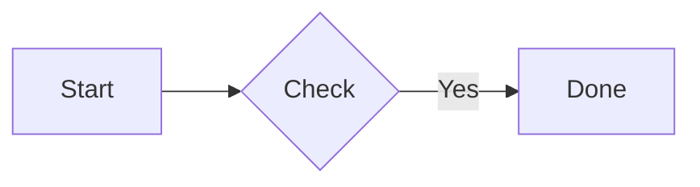

# EasyNote

[简体中文](README.md) | [English](README.en.md)

Current Version: `1.4.1`

A self-hosted Markdown note-taking application for individuals and small teams. The frontend is React 19 + TypeScript + Vite packaged as an installable PWA. The server is a single Cloudflare Worker serving the API, remote MCP, OAuth and static assets; D1 stores accounts and notes, R2 stores private images and attachments, a Durable Object broadcasts changes, and a Cron trigger cleans up expired data every hour. PDFs are generated structurally with pdfmake and previewed page by page with PDF.js.

## Contents

[Implemented Features](#implemented-features) · [Architecture](#architecture) · [Quick Start](#quick-start) · [Deploying to Cloudflare](#deploying-to-cloudflare) · [Configuration](#configuration) · [API](#api) · [Syntax Cheatsheet](#syntax-cheatsheet) · [Shortcuts](#shortcuts) · [Verification](#verification) · [Cost](#cost) · [Scope](#scope) · [Release Notes](#release-notes)

## Implemented Features

**Notes and editing**

- Create notes with an independent title, Markdown editing and preview, autosave 500 ms after typing stops, pinning, archiving, tags, trash and restore; permanent deletion asks for confirmation.
- CodeMirror 6 editor; markdown-it parsing with DOMPurify sanitizing; GFM tables, footnotes, syntax highlighting and safe HTML blocks.
- Tick to-dos directly in preview; double-click a heading, paragraph, list item, table or code block to jump back to its source line and column.
- Outline, backlinks and stable internal links `[[note UUID|display title]]` that keep working after the target is renamed; a `[TOC]` paragraph of its own (surrounded by blank lines) builds a clickable note contents that matches preview, shares and PDF.
- KaTeX inline and block math; Pele renders flowcharts, mind maps, sequence diagrams and more, recolouring instantly with the light/dark theme. Save an individual diagram as SVG or PNG from preview or a share page; prefer SVG for vector clarity and smaller files, or PNG for apps that do not support SVG.
- Version history: manual saves and AI writes create snapshots (20 kept by default) that can be inspected and restored; restoring snapshots the current content first.
- Multi-device collaboration: a Durable Object WebSocket pushes account-level change signals, the client pulls authoritative data incrementally, and a 30-second foreground poll covers gaps.

**Organisation and search**

- Folders up to 5 levels deep with create, rename, move and delete; sibling names stay unique.
- Drag notes or folders across levels and reorder siblings, or nudge with Alt+↑ / Alt+↓; lists sort by recent change or manual order, with the preference stored per account in the browser.
- Global search with `Cmd/Ctrl+K`, tag filters and a quick-jump command palette.
- Task centre aggregating every unfinished TODO with its source note and line number, one click away from the source.

**Sharing and AI access**

- Read-only share links valid for 1 hour / 1 day / 7 days / 30 days / forever, extendable or revocable; only the token hash is stored and attachments are authorised against the current revision.
- Remote MCP: any MCP client can connect to `https://your-domain/mcp` for search, batch reading and write tools.
- OAuth support (dynamic client registration + PKCE S256) with read-only or read-write authorisation; each grant creates an integration token named after the client, revocable from settings.
- AI writes land in the regular version history, and search uses FTS5 trigram with BM25 relevance ranking.

**Offline and PWA**

- Installable PWA: the app shell and preview scripts are precached for offline cold start and a standalone app window.
- A per-account IndexedDB library is enabled by default and mirrors note bodies, private files, full-text search and pending drafts; drafts are submitted automatically with the original revision and operationId once the session is valid, and conflicts go through explicit merging.
- An editor lock keeps one editing window per account; an installed PWA reclaims the lock when it returns to the foreground.

**Accounts and security**

- Multi-user tenancy: initial admin, approval-based self-registration, recovery codes, account deletion, HttpOnly session cookies, CSRF, origin checks and login rate limits; notes, versions, attachments, shares and AI tokens are all scoped by `user_id`, and R2 keys are shaped `<user_id>/<file_id>`.
- Changing a password or signing out everywhere revokes other browser sessions and all AI tokens; administrators always keep their own account usable.
- Private uploads use quota reservation and a state machine (pending → ready → deleting), with unreferenced objects cleaned up after a grace period.

**Import, export and operations**

- ZIP v3 export and import preserve folder structure and manual ordering keys (v2 archives stay importable); Obsidian folders, generic Markdown/TXT ZIPs and single or multiple `.md` / `.markdown` / `.txt` files import as well, rewriting external links into stable internal ones.
- PDF export offers a page-by-page preview, A4/Letter, portrait or landscape and zoom; the desktop downloads directly while iOS and Android open the system share sheet.
- `backup.sh` exports the full D1 snapshot and verifies every R2 object by size and SHA-256; `restore.sh --check` runs a read-only preflight, and a real restore only writes to empty resources.
- Cron cleans up expired sessions, shares, login counters, unreferenced files and the tenant data of accounts pending deletion every hour.

## Architecture

```text
Browser / PWA (React 19 + TypeScript + Vite)
   │  HTTPS: /api/*  /mcp  /oauth/*  / static assets
   ▼
Cloudflare Worker (src/worker, src/ai)
   ├── D1              accounts, sessions, notes, versions, folders, sync sequence, FTS5, shares, tokens
   ├── R2              private images and attachments (<user_id>/<file_id>)
   ├── Durable Object  NoteEvents: account-level change broadcast with WebSocket Hibernation
   └── Cron (hourly)   cleanup and tenant deletion
```

### Key mechanisms

- **Concurrency**: every write submits a `revision` and a random `operationId`; a revision mismatch returns `409` with the server version, and the client resolves it with a three-way merge (`node-diff3`) from the edit base or by creating a conflict copy.
- **Incremental sync**: `note_changes` keeps a monotonic sequence, `/api/sync` pulls full notes and deletions by cursor, and the WebSocket carries only invalidation signals.
- **Offline submission**: drafts and mirrors live in IndexedDB and retry idempotently with the original `operationId` once the session is valid.
- **Deletion**: deletes write a 30-day tombstone that stops old devices recreating a note from a stale revision; the scheduled cleanup removes the tombstone and frees the ID.
- **Migrations**: `0001_initial` is the schema baseline and `0002`–`0005` add OAuth, folders, manual ordering and the task scan index; the deploy script applies them before releasing code.

### Project structure

```text
src/
├── client/                 # frontend
│   ├── App.tsx             # login, workspace, settings and dialogs
│   ├── Editor.tsx          # CodeMirror and safe Markdown preview
│   ├── useNotebook.ts      # autosave, revision conflicts, lists and polling
│   ├── merge.ts            # three-way note merge
│   ├── drafts.ts           # IndexedDB drafts, offline mirror and private files
│   ├── api.ts              # API calls and uploads
│   ├── pdf.ts              # structured PDF generation, pagination preview and export
│   ├── transfer.ts         # ZIP export, validation, file remapping and import
│   ├── math.ts / knowledge.ts / i18n.ts / feedbackConfig.ts
│   ├── UserManagement.tsx / NoteSharing.tsx / ShareManagement.tsx / AccountSecurity.tsx / AiAccess.tsx
│   └── styles.css / main.tsx
├── worker/                 # server
│   ├── index.ts            # request entry and cron
│   ├── auth.ts             # users, sessions, recovery, admin and rate limits
│   ├── notes.ts            # notes, tags, versions, soft delete and purge
│   ├── events.ts           # Durable Object change notifications
│   ├── images.ts           # private files, quota reservation, status and cleanup
│   ├── oauth.ts            # OAuth authorisation server
│   ├── features.ts         # task centre and read-only sharing
│   ├── integrations.ts     # AI tokens, snapshots, incremental sync and controlled writes
│   └── core.ts             # config validation, size limits and shared types
├── ai/
│   ├── index.ts            # remote MCP tools and Resources
│   └── client.ts           # MCP internal API client
└── shared/types.ts         # shared types and limits
migrations/                 # D1 schema and incremental migrations
scripts/                    # setup / maintenance / cloudflare / deploy orchestration
test/                       # Miniflare API tests, Playwright browser tests and script tests
```

## Quick Start

Node.js 22.12 or later (npm included) and Bash on macOS / Linux are required; dependencies install from `package-lock.json`.

```bash
cd easynote
bash dev.sh
```

The first run prepares dependencies and creates a local administrator interactively, then builds, initialises local D1/R2 and starts the server at `http://127.0.0.1:8791`; stop it with `Ctrl+C`. For frontend hot reload, start the server and run `npm run dev:client` in another terminal (`http://127.0.0.1:5174`).

| Command | Purpose |
| --- | --- |
| `bash setup.sh` | Prepare dependencies and the local account without starting the server |
| `bash dev.sh [--port 8793]` | Start locally, initialising the account when missing |
| `bash deploy.sh` / `bash deploy.sh --check` | Interactive production deploy / local build and deploy preflight |
| `bash reset-password.sh --local` / `--remote` | Reset a local / production account and revoke its sessions and AI tokens |
| `bash backup.sh --remote` | Create and verify a full D1/R2 disaster-recovery set |
| `bash restore.sh <dir> --remote [--check]` | Preflight or restore into empty D1/R2 |
| `bash reset.sh --local` / `--remote` | Wipe local / cloud D1, R2 and the Worker after confirmation |
| `npm run test:ai` | Test the remote Streamable HTTP MCP |

Every script supports `--help`. Production requires HTTPS; only local commands allow loopback HTTP.

## Deploying to Cloudflare

1. **Enable R2**: complete the one-time account-level checkout in the Cloudflare Dashboard under **Storage & databases → R2 → Overview**; once **Create bucket** appears you can return to the terminal. The deploy script creates or reuses a dedicated D1 database and private R2 bucket from your token.
2. **Choose a public entry point**: leave it empty for `workers.dev` (the script can initialise the account subdomain), or enter a full hostname such as `notes.example.com` to use a Worker Custom Domain.
3. **Create a custom API token** ([My Profile → API Tokens](https://dash.cloudflare.com/profile/api-tokens/)) with Account Resources limited to the target account:

| Scope | Permission | Level | Purpose |
| --- | --- | --- | --- |
| Account | Account Settings | Read | Discover the accounts the token can reach |
| Account | Workers Scripts | Edit | Create or update the Worker, static assets, cron and secrets |
| Account | D1 | Edit | Inspect or create the database and run migrations |
| Account | Workers R2 Storage | Edit | Inspect or create the private bucket |
| Zone | Zone | Read | Find the Active zone of a Custom Domain |
| Zone | Workers Routes | Read | Check route conflicts for the hostname |

The last two are only needed with a Custom Domain, together with Zone Resources limited to the root domain. The token is typed into a hidden prompt and lives for that run only; `wrangler.deploy.json` stores resource identifiers with `0600` permissions.

4. **Deploy**: `bash deploy.sh`. The script prepares dependencies, checks and builds, creates any missing D1 database, private bucket and account subdomain, applies migrations, deploys the Worker and verifies public DNS and HTTPS. Typing `deploy <Worker name>` confirms both the change set and the pending migrations.

To update an existing deployment, run `git pull --ff-only` in the repository root and then `bash deploy.sh` again; the script reuses the saved account and resources, applies the migrations in `migrations/` that have not run yet, and updates the Worker.

Official references: [Wrangler API token](https://developers.cloudflare.com/workers/wrangler/system-environment-variables/), [Workers permissions](https://developers.cloudflare.com/workers/authorization/), [Custom Domains](https://developers.cloudflare.com/workers/configuration/routing/custom-domains/).

## Configuration

Server parameters are declared in `wrangler.json` under `vars` and validated for type and range at use time.

| Variable | Default | Meaning |
| --- | --- | --- |
| `MAX_NOTE_BYTES` | 262144 | 256 KiB per note body |
| `MAX_IMAGE_BYTES` | 8388608 | 8 MiB per image |
| `MAX_IMAGE_PIXELS` | 40000000 | 40 million pixels per image |
| `MAX_ATTACHMENT_BYTES` | 20971520 | 20 MiB per attachment |
| `IMAGE_QUOTA_BYTES` | 1073741824 | 1 GiB of R2 files per account |
| `MAX_NOTES` | 5000 | Notes per account, trash included |
| `VERSIONS_KEPT` | 20 | History snapshots per note; the current body lives in `notes` |
| `IMAGE_GRACE_HOURS` | 168 | Grace period before unreferenced files are cleaned |
| `SESSION_DAYS` | 30 | Fixed session lifetime |
| `AUTOSAVE_MS` | 500 | Save delay after typing stops (milliseconds) |
| `POLL_SECONDS` | 30 | Foreground sync interval |
| `LOGIN_WINDOW_SECONDS` / `LOGIN_IP_LIMIT` / `LOGIN_GLOBAL_LIMIT` | 900 / 20 / 200 | Login rate limit window, per-IP budget and instance-wide failed-attempt budget |
| `ACCOUNT_WINDOW_SECONDS` | 900 | Window for registration, recovery and OAuth client counters |
| `REGISTRATION_IP_LIMIT` / `REGISTRATION_GLOBAL_LIMIT` | 5 / 50 | Registration rate limits |
| `PASSWORD_RESET_IP_LIMIT` / `PASSWORD_RESET_GLOBAL_LIMIT` | 5 / 50 | Recovery-code rate limits |
| `OAUTH_CLIENT_IP_LIMIT` / `OAUTH_CLIENT_GLOBAL_LIMIT` | 20 / 200 | OAuth client registration rate limits |
| `ALLOW_LOCAL_HTTP` | false | Loopback HTTP switch for local commands |

Titles are limited to 256 characters, tags to 20 per note and 40 characters each, and a note may reference up to 80 private files; those rules live in `src/worker/notes.ts`. The client success-toast duration is `SUCCESS_FEEDBACK_DURATION_MS` in `src/client/feedbackConfig.ts` (2000 milliseconds by default).

## API

| Method / path | Purpose |
| --- | --- |
| `GET /api/session` | Account state, CSRF and client parameters |
| `POST /api/login` / `POST /api/logout` / `POST /api/register` | Sign in, sign out, request registration |
| `POST /api/account/password` / `logout-all` / `recovery-code` / `reset-password` | Change password, sign out everywhere, issue a recovery code, reset with one |
| `DELETE /api/account` | Request deletion of the current tenant |
| `GET/POST /api/admin/users`, `PATCH/DELETE /api/admin/users/:id`, `PATCH /api/admin/settings/registration` | Admin user management and the registration switch |
| `GET /api/events` | Same-origin WebSocket for account change signals |
| `GET /api/sync`, `GET /api/sync/cursor` | Incremental sync of full notes and deletions by monotonic sequence |
| `GET /api/tasks` | Unfinished TODOs with source locations, paginated by `cursor` (`updated_at:id`) and `limit` (50) |
| `GET /api/notes` | List, search, views and tag filters, 50 per page |
| `POST /api/notes/duplicates` | Batch lookup of existing note content fingerprints |
| `POST /api/notes/:id`, `GET /api/notes/:id`, `PUT /api/notes/:id`, `DELETE /api/notes/:id` | Create (revision 0), read, update by revision, permanently delete |
| `GET /api/notes/:id/versions`, `GET /api/notes/:id/backlinks`, `GET /api/tags` | Version history, backlinks, tags |
| `GET /api/shares`, `GET/POST/PATCH/DELETE /api/notes/:id/share` | Share list, creation, extension and revocation |
| `GET /api/public/shares/:token`, `/public/shares/:token/(images\|files)/:id` | Anonymous read of a valid share and its referenced files |
| `PUT/GET /api/images/:id`, `PUT/GET /api/files/:id` | Upload or authorised read of images and attachments |
| `GET/POST /api/integrations/tokens`, `DELETE /api/integrations/tokens/:id` | Create, list and revoke AI integration tokens |
| `GET /api/integrations/notes`, `/notes/batch`, `/notes/:id`, `POST/PUT /api/integrations/notes/:id` | Bearer-token search (batches of up to 20), read and controlled write |

Browser write endpoints require a same-origin `Origin` and `X-CSRF-Token`; AI endpoints use a dedicated Bearer token. Every data endpoint is scoped per account.

## Syntax Cheatsheet

| Syntax | Usage |
| --- | --- |
| `- [ ] todo` / `- [x] done` | Tick in preview, written straight back to the source |
| `[[note UUID\|display title]]` | Internal link that survives a rename |
| A `[TOC]` paragraph of its own (blank lines around it) | Builds a clickable note contents indented by heading level; quoted headings are left out and PDF keeps the contents as text |
| `$x^2$` / `$$…$$` | Inline / block math (KaTeX) |
| `text[^1]` plus `[^1]: note` | Footnote with jump and back-jump |
| A ` ```mermaid ` block | Diagrams; start with `flowchart LR`, `mindmap`, `sequenceDiagram` and so on. Use the top-right controls to save a diagram as SVG or PNG |
| A ` ```python ` block | Syntax highlighting, unknown languages fall back to plain text |
| `\| :--- \| :---: \| ---: \|` | GFM table alignment for left, centre and right |
| HTML block | Sanitised by DOMPurify, keeping safe structural tags such as `<section>`, `<mark>`, `<kbd>`, `<details>` and `<summary>` |

````markdown

````

Import the demos to see the rendering: [`examples/markdown-syntax-demo.en.md`](examples/markdown-syntax-demo.en.md) (all syntax), [`examples/math-demo.md`](examples/math-demo.md) (math mixed with diagrams), [`examples/mermaid-all-types-demo.md`](examples/mermaid-all-types-demo.md) (20 diagram types), [`examples/mermaid-html-demo.md`](examples/mermaid-html-demo.md) (diagrams with HTML blocks).

## Shortcuts

| Shortcut | Action |
| --- | --- |
| `Cmd/Ctrl+K` | Focus global search with the current keywords selected, across all folders |
| `Cmd/Ctrl+O` | Open quick jump to search notes or run commands |
| `Cmd/Ctrl+Enter` | Create a note in the current folder |
| `Cmd/Ctrl+S` | Save, sync and record a version immediately |
| `Cmd/Ctrl+E` | Toggle editing and preview, keeping the source caret |
| `Cmd/Ctrl+,` | Open settings |
| `Cmd/Ctrl+\` | Show or hide the navigation sidebar; open the nav menu on narrow screens |
| `Cmd/Ctrl+.` | Show or hide the outline and backlinks |
| `Cmd/Ctrl+Shift+K` | Insert an internal note link |
| `Cmd/Ctrl+Shift+L` | Toggle the dark or light theme |
| `Cmd/Ctrl+B` / `Cmd/Ctrl+I` | Toggle bold / italic |
| `Cmd/Ctrl+Shift+Z` / `Ctrl+Y` | Redo |
| `Cmd/Ctrl+P` | Export the current note as PDF |
| `Cmd/Ctrl+/` | Show the shortcut list |

`Cmd/Ctrl+Shift+F` remains a compatible global-search shortcut, and global shortcuts yield to input while a dialog is open.

## Verification

```bash
bash deploy.sh --check
npm run build          # type checks + i18n check + build
npm test               # API and AI tests
npm run test:scripts   # script flow tests (temp dirs, mock Wrangler)
npx playwright install chromium && npm run test:ui
```

API tests run against in-memory D1 / R2, and browser tests start an isolated instance on `127.0.0.1:8792`; test accounts and data exist only in the test environment. Script tests use mock npm / Wrangler, and interactive flows drive a pseudo-terminal through the system `expect`.

Coverage spans multi-tenant isolation, approval-based registration, recovery and account deletion, save conflicts and idempotency, task locations, timed and permanent shares, ZIP and Obsidian imports, offline cold start and submission, AI tokens and real MCP, deletion tombstones, private files, disaster-recovery validation, mobile layouts and the editor lock.

## Cost

Billing covers Workers, D1 and R2 Standard; prices were checked on 2026-09-17. Individuals and small teams usually stay inside the free tier.

| Item | Free tier | Overage |
| --- | --- | --- |
| Worker dynamic requests | 100,000/day | 10 million/month included, then `$0.30` per million |
| Worker CPU | 10 ms per request | 30 million CPU-ms/month included, then `$0.02` per million |
| D1 row reads / writes | 5 million / 100,000 per day | 25 billion / 50 million per month included, then `$0.001` / `$1.00` per million |
| D1 storage | 5 GB (500 MB per database) | `$0.75` per GB-month |
| R2 Standard storage | 10 GB-month/month | `$0.015` per GB-month |
| R2 Class A / Class B | 1 million / 10 million per month | `$4.50` / `$0.36` per million |
| D1 / R2 egress | Free | — |

Typical usage:

| Scenario | Estimated monthly cost |
| --- | ---: |
| 1,000 notes, 20 KiB average, 5 versions, ≤ 1 GiB attachments, one device | **$0** |
| 1,000 notes, 20 KiB average, close to 20 versions (~410 MiB of raw bodies; indexes can push past 500 MB) | **$0, or from $5** |
| 1,000 notes, 50 KiB average, 10 versions (raw bodies already exceed the free single-database limit) | **from $5** |
| D1 within limits, R2 totalling 20 GB / 50 GB | about `$0.15` / `$0.60` |

Autosave only rewrites the current body, while version slots are consumed by manual saves and AI writes, so setting `VERSIONS_KEPT` to 5–10 leaves plenty of D1 headroom. After going live, watch Workers Requests, CPU Time and Error 1027, D1 `rows_read`, `rows_written` and database size, plus R2 storage and operations — adjust `POLL_SECONDS`, `VERSIONS_KEPT` or the plan once any of them reaches 70% of the free tier. These figures exclude domains, taxes and external backup storage; your invoice is authoritative: [Workers pricing](https://developers.cloudflare.com/workers/platform/pricing/), [D1 pricing](https://developers.cloudflare.com/d1/platform/pricing/), [D1 limits](https://developers.cloudflare.com/d1/platform/limits/), [R2 pricing](https://developers.cloudflare.com/r2/pricing/).

## Scope

- The product focuses on Markdown notes, per-note read-only sharing and remote MCP; AI reaches a tenant through a restricted token the user creates.
- The offline mirror inherits the security boundary of the browser profile and device account, so disk encryption is recommended on sensitive devices.
- Data is protected by access control inside your Cloudflare account, where the account administrator has infrastructure-level access.
- Lists use offset pagination, so page boundaries can be refreshed manually after content arrives from another device; AI search runs on FTS5, with semantic vector search as a possible extension.
- Before going to production, verify account configuration, backup and restore, and Cloudflare usage on a separate temporary instance.

## Release Notes

`1.4.1` (2026-10-19): contents entries no longer generate duplicate counters and use indentation to show hierarchy; navigation, shares, the reader window and PDF behaviour are unchanged.

`1.4.0` (2026-10-19): note contents arrive — a `[TOC]` paragraph builds a clickable table of contents (quoted headings excluded) across preview, shares, the reader window and PDF; diagrams can be saved as SVG / PNG using the current theme.

The version source of truth is `package.json` in this directory, with sync rules in [`version.config.json`](version.config.json); the root `versions.json` and version table are generated. Before committing a feature update, run in the repository root:

```bash
node scripts/version.mjs bump easynote patch   # minor for features, major for breaking changes
node scripts/version.mjs check
```

The script syncs this README, the root README, `package.json`, the lockfile and the version shown in the app from that config.

- Full release history: [`CHANGELOG.en.md`](CHANGELOG.en.md)
- AI / MCP setup: [`docs/AI_INTEGRATION.en.md`](docs/AI_INTEGRATION.en.md)
- Backup and restore: [`docs/DISASTER_RECOVERY.en.md`](docs/DISASTER_RECOVERY.en.md)
- Importable syntax and diagram samples: [`examples/`](examples/)
