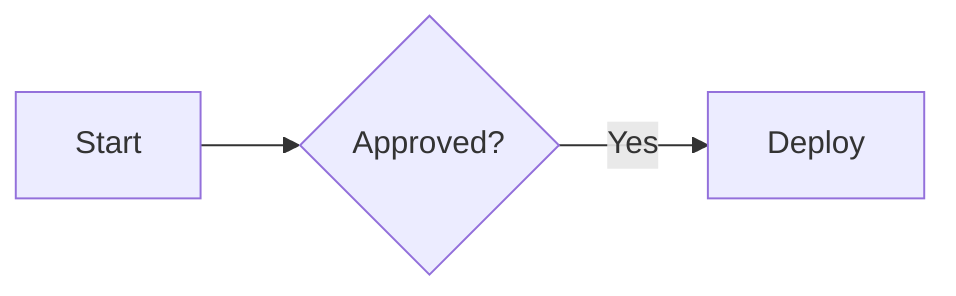

# EasyNote

[简体中文](README.md) | [English](README.en.md)

Current Version: `1.1.0`

A self-hosted Markdown note-taking application for individuals or small teams. React + TypeScript frontend, pdfmake PDF generation with PDF.js paginated preview, Cloudflare Worker API, D1 database for accounts and notes, and private R2 object storage for images and attachments.

## 1.1.0 Release Notes (2026-10-16)

- On desktop, drag folders to reorder siblings or move them into another folder, and drag a selection of notes into a folder or Root. Folder depth, sibling-name uniqueness and cycle checks remain enforced.
- Root stays visible. Each folder can independently use Manual order or Last modified, with preferences stored per account in the current browser. Manual order supports dragging and Alt+Up / Alt+Down; search, tag and All Notes lists retain last-modified ordering.
- Reordering notes changes only their positions, preserving content, revisions and modification times. Cross-device position updates retain unsaved drafts and rebuild pagination in manually ordered lists.
- Upgrading to 1.1.0 requires `0004_order.sql`, which adds note and folder positions and a sorting index. The existing deployment script applies migrations before publishing code. ZIP restores preserve folders but not manual order. Mobile continues to use action menus; moving and reordering require a connection.
- Fix web ChatGPT MCP authorization: PWA navigation no longer intercepts OAuth, discovery metadata, MCP or share paths. Consent submissions strictly validate a same-origin Origin, falling back to a same-origin Referer only when Origin is absent, allowing popup cross-site markers and Referer-only submissions.
- Fix MCP search results being rejected when internal sorting fields are present. Upgrades from older versions must also have `0002_oauth.sql` applied; the deployment script checks and applies all pending migrations.

## 1.0.0 Release Notes (2026-10-16)

- Show the folder tree directly below All Notes instead of in a separate Folders section, with the same hierarchy order on desktop and mobile.
- Right-click All Notes on desktop to create a root folder, or open the menu with Shift+F10 or the menu key. Escape closes it and returns focus to All Notes; clicking outside or pressing Tab also closes it.
- Keep the New Folder touch entry in mobile navigation. Folder creation is disabled offline; existing folders and cached notes remain available.
- Upgrading from 0.11.0 requires no new database migration. Existing folders, notes and folder actions remain compatible.

## 0.11.0 Release Notes (2026-10-16)

- Add a folder tree in the sidebar, five levels deep, with create, rename, move and delete. Moving a folder carries its whole subtree and the notes inside it, and a folder can never be moved into itself or its own subtree.
- The note list gains a right-click menu for copy, edit, move and delete. The offline library mirrors the folder list, and AI/MCP note metadata now reports `folderId`.
- Sibling folder names stay unique: create, rename, move, ZIP import and disaster-recovery restore all validate the same rule and return 409 on a clash. Migration `0003_folders.sql` adds a unique sibling index as a backstop, using `COALESCE` so root folders with a `NULL` parent are compared too.
- One account may hold at most 1200 folders, matching the ZIP import and export budget. Importing merges same-name siblings and always generates new UUIDs for created folders, so a folder ID owned by another account no longer aborts the import.
- Folder restore creates each level with up to six concurrent requests, cutting the wait for large archives on slow networks.
- Disaster-recovery backups include folders, and the restore precheck now rejects old backups that contain duplicate sibling names. Deployments apply database migrations before the new code.

## 0.10.2 Release Notes (2026-10-15)

- Reduce the default autosave delay from 1000 ms to 500 ms. Edits made during a save keep their existing debounce deadline and save immediately once it has elapsed, without waiting another full interval. The saved status still requires server confirmation.
- Deliver cross-device change notifications in the background so they no longer delay completed save responses; retain failure logging and polling recovery.
- Register the offline worker before the full page finishes loading, using a deferred registration script while preserving immediate activation and control of the page.
- Treat PDF resources as an optional background cache: preparation failures no longer interrupt editing, saving, or enabling offline notes. Export failures appear in the PDF dialog. Offline PDF export may remain unavailable if the resources were not cached successfully.
- Add regression coverage for slow page resources, PDF cache failures, edits during saves, and background notifications. The database schema and migrations are unchanged.

## 0.10.1 Release Notes (2026-10-15)

- Fewer database round trips when saving a note: the current revision and the purge tombstone are read in one batch, and the save response comes from the write itself via `RETURNING` instead of a follow-up read, so the response always matches the revision that was written.
- Load the note list and the tag list in parallel, removing one serial round trip. A failed list refresh after a successful save is no longer treated as a save failure and no longer blocks further autosaves of that note (the content is already on the server); the list catches up on the next poll.
- The database schema and migrations are unchanged: upgrading from 0.10.0 needs no extra migration or backup step.

## 0.10.0 Release Notes (2026-10-15)

- Add OAuth authorization for remote MCP: clients that only support OAuth, such as ChatGPT on the web, can connect to `/mcp` directly, with automatic client registration and PKCE (S256). The consent page asks for the account password and a read-only or read-write access level.
- Each authorization creates one integration token named after the client, listed under "Settings → AI Integration", revocable at any time, and sharing the limit of 10 active tokens per account with manually created tokens.
- Access tokens last 1 hour. Refresh tokens last 30 days and rotate on every refresh; reusing a rotated-out refresh token revokes that authorization immediately. Changing a password, disabling an account, an administrator password reset, or account deletion also revokes OAuth grants.
- OAuth endpoints accept HTTPS only: client registration uses the `ACCOUNT_WINDOW_SECONDS` window, consent submissions reuse the login rate limit, and unknown `/.well-known/*` paths return a JSON 404 instead of the app shell.
- Deployments apply database migrations before the new code. Disaster-recovery backups include the new OAuth client table; after the migration version changes, restore older backups with matching code.

## 0.9.0 Release Notes (2026-10-15)

- Add KaTeX inline and display math, including offline cold starts, shared and separate readers, PDF exports, and an importable example. PDF export rasterizes formulas and their containing paragraphs, headings, list items, or table cells; text inside those images cannot be selected or searched.
- Browser connectivity hints no longer block sync or image requests. Network failures and HTTP errors update connectivity separately, including when the offline library is disabled. The task center uses mirrored notes and unsynced drafts when the offline library is enabled.
- Retry temporary save failures up to twice with the same operation ID; prevent delayed reads from overwriting newer synchronized content or purge tombstones.
- Fix PDF exports containing math and Mermaid in the same list item, preserve image dimensions, reuse decoded images when their sources become unreachable if the canvas can read them, and report other images as unwritable, and cover large images mixed with inline math.
- Build current source before UI tests, update stale selectors, include client API and math parser tests in the regular test command, and remove unused translation keys.

## 0.8.7 Release Notes (2026-10-09)

- Fix the editor-lock screen when switching from a browser tab to the installed PWA. A foreground PWA automatically takes over; waiting pages resume when the previous editor closes, while preserving one editor per account and browser profile.
- Add an in-app history entry when opening a note on mobile. System Back returns to the note list, and Forward restores the note view. The Back button waits for history traversal before displaying the list to avoid races when reopening quickly.
- Disable horizontal overscroll navigation while retaining horizontal scrolling in code blocks and tables.
- Add regression coverage for PWA takeover, editor-lock recovery, and mobile Back/Forward; update existing mobile navigation tests to use the current button labels.

## Implemented Features

- Multi-tenant model: Initial admin provisioning, user management, approval-based registration (disabled by default), recovery codes, account deletion, HttpOnly session cookies, CSRF, origin checks, and login rate limiting. Notes, versions, attachments, offline caches, and AI tokens are strictly tenant-isolated.
- Note creation, standalone title, Markdown editing/preview, checkable tasks, autosave, pinning in the note list, archive, tags, and full-text keyword search.
- Task Center: Aggregates incomplete Markdown TODOs with source note and line number references, with direct jump-to-source support.
- Single blank note rule: Keeps at most one completely blank note per account; creating a new note reuses an existing blank note if present.
- CodeMirror 6 editor, markdown-it parsing with DOMPurify sanitization, supporting footnotes, code highlighting, and safe HTML blocks.
- Mermaid diagrams: Flowcharts, mindmaps, and other Mermaid charts rendered on-demand in preview mode.
- KaTeX math: `$x^2$` inline and `$$…$$` display formulas, including offline previews, separate readers, shares, and PDF exports. Code and ordinary currency remain literal.
- Image pasting, drag-and-drop, and file selection (JPEG, PNG, WebP); private attachments (PDF, Markdown, TXT, CSV, JSON); inserted at cursor position.
- PDF export with authentic paginated preview, A4/Letter formats, portrait/landscape orientation, and scaling; direct download on desktop, system share sheet on iOS/Android.
- Trash bin, restore, permanent deletion, and tombstone records preventing stale devices from resurrecting purged notes.
- Revision-based concurrency control, 3-way merge from base revisions, manual conflict resolution with conflict copies, idempotent retries, manual snapshot history, and version restore.
- Full offline note library (enabled by default): IndexedDB mirrors note content, private files, full-text search, and pending drafts, automatically submitting changes upon reconnecting. Browser connectivity hints do not block requests; temporary network or server save failures get up to two automatic retries before requiring manual sync.
- Durable Object WebSockets broadcast mutation signals (create, update, delete) per account; clients fetch authoritative data upon notification. Foreground polling and focus restoration act as fallbacks.
- Installable PWA with a standalone app window, home screen icon, app shell caching, and offline cold start. Notes can open in a regular separate reader window on desktop (omitted on mobile); system-level always-on-top is not supported.
- Searchable command palette (`Cmd/Ctrl+K`), document outline, stable internal links (`[[UUID|Title]]`), and backlinks.
- Tag renaming, merging, deletion, plus batch archive and tagging.
- AI read/write integration: Restricted tokens, exact note statistics, cross-status FTS5 relevance search, match character ranges, batch reading, MCP Resources, and writing tools. AI edits enter version history.
- Desktop/mobile layouts, light/dark themes, ZIP export/recovery, and import support for Obsidian directories, Markdown/TXT ZIPs, and individual files.
- Revocable time-limited or permanent read-only share links with centralized management.
- Scheduled cleanup of expired sessions, share links, login counters, unreferenced files, failed uploads, and deleted tenant data.

## Project Structure

```text
easynote/
├── src/
│   ├── client/
│   │   ├── App.tsx            # Login, workspace, settings, and dialogs
│   │   ├── Editor.tsx         # CodeMirror and sanitized Markdown preview
│   │   ├── useNotebook.ts     # Autosave, revision conflicts, list, polling
│   │   ├── merge.ts           # 3-way merge and conflict detection
│   │   ├── drafts.ts          # IndexedDB drafts, offline mirror, private files
│   │   ├── api.ts             # API client, error handling, private file uploads
│   │   ├── pdf.ts             # Structured PDF generation and paginated preview
│   │   ├── transfer.ts        # ZIP export, validation, remapping, import
│   │   ├── UserManagement.tsx  # Admin user and registration management
│   │   ├── NoteSharing.tsx     # Single-note read-only sharing
│   │   ├── ShareManagement.tsx # Share list, renewal, and revocation
│   │   ├── styles.css
│   │   └── main.tsx
│   ├── worker/
│   │   ├── index.ts           # Request routing and Cron triggers
│   │   ├── auth.ts            # Multi-user, sessions, recovery, admin, rate limits
│   │   ├── events.ts          # Durable Object WebSocket mutation notifications
│   │   ├── features.ts        # Task center and read-only sharing
│   │   ├── integrations.ts    # AI tokens, snapshots, delta sync, controlled writes
│   │   ├── notes.ts           # Notes, tags, versions, soft delete, purging
│   │   ├── images.ts          # Private files, quota reservation, cleanup
│   │   └── core.ts            # Config validation, limits, errors, shared types
│   ├── ai/
│   │   ├── index.ts           # Remote MCP tools and Resources
│   │   └── client.ts          # MCP internal API client
│   └── shared/types.ts
├── docs/AI_INTEGRATION.md     # User and AI integration guide
├── docs/DISASTER_RECOVERY.md  # Backup and disaster recovery procedures
├── migrations/                # Initial D1 schema and incremental upgrades
├── scripts/                   # Setup, maintenance, Cloudflare API, deployment
├── test/                      # Integration and UI tests
├── setup.sh                  # Prepare local dependencies and admin
├── dev.sh                    # One-command local development server
├── deploy.sh                 # Interactive production deployment
├── backup.sh                 # Interactive D1/R2 disaster recovery backup
├── restore.sh                # Backup verification and restore
├── reset-password.sh         # Interactive password recovery
├── wrangler.json             # Worker config, bindings, and environment variables
├── vite.config.ts
└── playwright.config.ts
```

## Local Development

Requires Node.js 22.12 or later and Bash (macOS / Linux).

```bash
cd easynote
bash dev.sh
```

First launch automatically installs dependencies and interactively prompts for initial admin credentials, builds the frontend, applies D1 migrations, and starts the service. Access at `http://127.0.0.1:8791`.

| Command | Description |
| --- | --- |
| `bash setup.sh` | Install dependencies and initialize admin without starting the server |
| `bash dev.sh` | Start local development server (auto-initializes if unconfigured) |
| `bash dev.sh --port 8793` | Start on custom port |
| `bash deploy.sh` | Interactive production deployment |
| `bash deploy.sh --check` | Local build and Wrangler preflight checks |
| `bash reset-password.sh --local` | Reset local account password |
| `bash reset-password.sh --remote` | Reset remote account password |
| `bash ../reset.sh easynote --local` | Clear local D1/R2 state while preserving admin config |
| `bash ../reset.sh easynote --remote` | Reset remote Cloudflare D1/R2 and Worker |
| `bash backup.sh --remote` | Create and verify full D1/R2 disaster recovery backup |
| `bash restore.sh <dir> --remote --check` | Preflight check for backup restoration |
| `bash restore.sh <dir> --remote` | Restore backup to empty D1/R2 resources |
| `npm run test:ai` | Test remote Streamable HTTP MCP integration |

### Version Management

Versions are maintained in [`versions.json`](../versions.json) at the repository root:

```bash
node scripts/version.mjs bump easynote patch
node scripts/version.mjs check
git add .
git commit -m "发布：EasyNote v0.4.4"
```

## Production Deployment

### 1. Enable R2

When using R2 for the first time, log into [Cloudflare Dashboard](https://dash.cloudflare.com/), go to **Storage & databases → R2 → Overview**, and complete the R2 subscription checkout. Once the **Create bucket** button appears, return to your terminal; manual bucket creation is not required.


The deployment script automatically discovers accounts based on your Token, creates or reuses dedicated `easynote-db` and private `easynote-images`, and retrieves the D1 UUID.

### 2. Choose Public Access

- Leave blank for `workers.dev` (creates an account-level subdomain if absent).
- Enter a custom domain (e.g. `notes.example.com`), which must belong to an Active Zone in the same account.

### 3. Create Custom API Token

Create a Custom API Token under [My Profile → API Tokens](https://dash.cloudflare.com/profile/api-tokens/):

- Account Settings: Read (to discover accounts)
- Workers Scripts: Edit (to create/update Worker, assets, and secrets)
- D1: Edit (to manage database and migrations)
- Workers R2 Storage: Edit (to manage private R2 bucket)
- (Custom Domain only) Zone: Read
- (Custom Domain only) Workers Routes: Read


### 4. Deploy

```bash
bash deploy.sh
```

Follow the prompts to enter your API Token, select or confirm resources, and finalize deployment.

## Key Behaviors

### Autosave & Conflicts

Autosave updates note content with `createVersion: false`. Explicit saves (`Cmd/Ctrl+S` or "Sync and Update Version") set `createVersion: true` to snapshot history. AI writes enforce version creation. Duplicate content does not create redundant history snapshots.

Simultaneous edits on different devices are resolved using revision numbers. Conflicts return `409 Conflict`, preserving local drafts and allowing users to branch into conflict copies without overwriting remote data.

Within one browser profile, Web Locks allow only one editor per account to protect local drafts. Waiting pages resume automatically when the editor closes. An installed PWA automatically takes over when it enters the foreground; browser tabs can request takeover with “Reopen”.

On mobile, opening a note adds an in-app history entry. System Back returns to the note list before leaving the app, and Forward restores the note view.

### Shortcuts & Navigation

`Cmd/Ctrl+K` opens the quick command palette for navigation, actions, search, and settings.

| Shortcut | Action |
| --- | --- |
| `Cmd/Ctrl+S` | Save, sync, and record version snapshot |
| `Ctrl+E` / `Cmd/Ctrl+Enter` | Toggle edit and preview mode (retains cursor position) |
| `Cmd/Ctrl+B` / `Cmd/Ctrl+I` | Toggle bold / italic in editor |
| `Cmd/Ctrl+P` | Export current note as PDF |
| `Cmd/Ctrl+/` | View keyboard shortcuts |
| `Esc` | Close dialogs |

Double-clicking any heading, paragraph, list item, table, or code block in preview mode instantly switches to edit mode and jumps to the exact source line in the editor.

### Heading Hierarchy & Outline

EasyNote provides a dedicated note title input; titles do not require Markdown `#` prefixes. The note body starts major sections with `##`, subsections with `###`, and so forth. The sidebar outline panel automatically generates a hierarchical table of contents from body headings for quick jumping.

### Interactive Task Lists

Use `- [ ] task` for incomplete items and `- [x] task` for completed items (`- [] task` shorthand is also supported). In preview mode, checkboxes can be directly clicked to toggle status, which automatically writes back to the Markdown source and saves.

```markdown
- [ ] Incomplete task
- [x] Completed task
```

The sidebar "Task Center" aggregates all uncompleted tasks across all non-deleted notes (including archived notes), while ignoring task syntax inside code blocks. Each entry displays its source note and line number, and clicking it jumps directly to that line in edit mode.

### GFM Tables

Supports standard GitHub Flavored Markdown tables with column alignment via colons:

```markdown
| Header 1 | Header 2 | Header 3 |
| :--- | :---: | ---: |
| Left-aligned | Center-aligned | Right-aligned |
```

Double-clicking a table in preview mode jumps to its Markdown source line. Tables automatically adapt to desktop and mobile viewport widths.

### Code Blocks & Syntax Highlighting

Code blocks use fenced syntax with language tags (powered by `highlight.js/lib/common`), supporting major languages such as `typescript`, `javascript`, `python`, `bash`, `json`, `html`, `css`, `yaml`, `sql`, `go`, etc. Unrecognized languages gracefully fall back to safe plain text. Double-clicking any code block navigates to its editor source line.

````markdown
```python
def hello_world():
    print("Hello from EasyNote")
```
````

### Footnotes

Supports standard Markdown footnote syntax:

```markdown
Body reference[^1] and additional note[^details].

[^1]: Detailed definition for the first footnote.
[^details]: Footnote content supports multi-line text and links.
```

In preview mode, clicking a superscript (e.g. `[1]`) smoothly scrolls down to the footnote definition at the bottom; clicking the backreference link (`↩︎`) smoothly returns to the citation in the body text.

### Knowledge Links (WikiLinks) & Backlinks

Use `[[Note UUID|Display Title]]` or `[[Note UUID]]` to build bidirectional links between notes. Links are permanently bound to the note's UUID, so renaming a target note's title will not break existing links. Clicking a link in preview mode directly navigates to the target note in-app.

```markdown
See reference document: [[00000000-0000-0000-0000-000000000001|Project Specification]]
```

The sidebar outline panel scans active notes in real time to display "Backlinks" (all notes referencing the current note), establishing a two-way knowledge graph.

### Diagrams, Math & HTML

Math supports `$x^2$` inline and `$$…$$` display formulas. `\(` and `\[` are Markdown escapes and stay literal so existing notes do not change. Code and ordinary currency remain literal. Each formula is limited to 10,000 source characters; `trust: false` prevents untrusted links and external images, `maxExpand: 1000` bounds macro expansion, and `maxSize: 20` bounds user-specified sizes. Invalid formulas retain their source; oversized or unclosed formulas remain plain text.

Import [`examples/math-demo.md`](examples/math-demo.md) to check formulas in lists and tables, including math mixed with Mermaid.

Flowcharts and mindmaps use Mermaid fenced code blocks and render automatically in preview mode, with full light/dark mode auto-theming:

````markdown

````

For mindmaps, set the first line to `mindmap` and indent child nodes. Common diagram types such as `sequenceDiagram`, `classDiagram`, and `stateDiagram` are also supported. Notes support up to 20 Mermaid diagrams, each up to 50,000 characters.

Safe HTML blocks can be embedded directly in Markdown, sanitized via DOMPurify. Safe structural tags like `<section>`, `<mark>`, `<kbd>`, `<details>`, `<summary>` are preserved; risky elements such as `<script>`, `<style>`, `<iframe>`, `<form>`, inline event handlers, and external media are stripped.

You can import [`examples/markdown-syntax-demo.en.md`](examples/markdown-syntax-demo.en.md) to test the complete rendering syntax showcase, or [`examples/mermaid-html-demo.md`](examples/mermaid-html-demo.md) for diagrams and HTML blocks.

### Images & Attachments

- **Private Image Syntax**: ``. Supports original image uploads (no lossy compression or EXIF stripping), lazy loading, offline IndexedDB cache fallback, and full-screen lightbox zoom upon clicking in preview mode.
- **Private Attachment Syntax**: `[Document.pdf](/api/files/<uuid>)`. For PDF, TXT, CSV, JSON, ZIP, etc., clicking the link in preview mode triggers a secure browser download with the `download` attribute and `nosniff` security header.
- **External Image Tracking Shield**: To prevent access tracking and privacy leaks, external HTTP(S) images are blocked by default and rendered with a placeholder (`[外部图片未加载]`).
- **Security & Storage**:
  - Image/attachment URLs use stable internal routes (`/api/images/<id>`), with no public buckets or temporary signed URLs.
  - Every file request verifies login and tenant ownership with `private, no-store` headers.
  - Files referenced by active notes, trash, or retained version snapshots are protected from deletion; unreferenced files are safely cleaned up after a grace period.

### PDF Export

PDF export provides a paginated preview with A4/Letter paper, portrait/landscape orientation, and scaling. Ordinary text remains selectable and searchable. Formulas and Mermaid diagrams are embedded as images; an entire paragraph, heading, list item, or table cell containing inline math becomes an image, so its text cannot be selected or searched. Raster images are limited to 2400 pixels on their longest side, which can reduce clarity for large blocks. Keep the Markdown source when searchable or copyable formula content is required.

### AI Integration (MCP)

EasyNote supports Model Context Protocol (MCP) natively:

1. Generate a token under "Settings → AI Integration" in the web app.
2. Connect your AI client (e.g. Codex) to `https://your-domain/mcp` using Bearer authentication.
3. AI agents gain permission-scoped access to search, read, create, or modify notes through standard MCP tools and resources. See [`docs/AI_INTEGRATION.en.md`](docs/AI_INTEGRATION.en.md) for full details.

## Configuration

Configured in `wrangler.json` under `vars`:

| Key | Default | Description |
| --- | --- | --- |
| `MAX_NOTE_BYTES` | 262144 | Maximum note body size (256 KiB) |
| `MAX_IMAGE_BYTES` | 8388608 | Maximum image size (8 MiB) |
| `MAX_IMAGE_PIXELS` | 40000000 | Maximum image pixels (40 MP) |
| `MAX_ATTACHMENT_BYTES` | 20971520 | Maximum attachment size (20 MiB) |
| `IMAGE_QUOTA_BYTES` | 1073741824 | Per-user R2 file quota (1 GiB) |
| `MAX_NOTES` | 5000 | Maximum notes per user (including trash) |
| `VERSIONS_KEPT` | 20 | Maximum historical snapshots per note |
| `IMAGE_GRACE_HOURS` | 168 | Retention grace period for unreferenced files |
| `SESSION_DAYS` | 30 | Session expiration duration in days |
| `AUTOSAVE_MS` | 500 | Autosave delay after typing stops, in milliseconds |
| `POLL_SECONDS` | 30 | Foreground sync polling fallback interval |
| `LOGIN_WINDOW_SECONDS` | 900 | Login attempt rate limit window |
| `LOGIN_IP_LIMIT` | 20 | Login attempts per IP within window |
| `LOGIN_GLOBAL_LIMIT` | 200 | Global login attempts within window |
| `ACCOUNT_WINDOW_SECONDS` | 900 | Counting window for registration, recovery and OAuth client registration |
| `REGISTRATION_IP_LIMIT` | 5 | Registration requests per IP within window |
| `REGISTRATION_GLOBAL_LIMIT` | 50 | Instance-wide registration budget within window |
| `PASSWORD_RESET_IP_LIMIT` | 5 | Password recovery requests per IP within window |
| `PASSWORD_RESET_GLOBAL_LIMIT` | 50 | Instance-wide password recovery budget within window |
| `OAUTH_CLIENT_IP_LIMIT` | 20 | OAuth client registrations per IP within window (`/oauth/register`) |
| `OAUTH_CLIENT_GLOBAL_LIMIT` | 200 | Instance-wide OAuth client registration budget within window |

## Verification

```bash
bash deploy.sh --check
npm run build
npm test
npm run test:ai
npm run test:scripts
npx playwright install chromium
npm run test:ui
```

### Folders and note actions

The folder tree appears below All Notes in the sidebar. On desktop, right-click All Notes and choose New Folder to create a root folder, or open the menu with Shift+F10 or the menu key. On mobile, tap New Folder in the navigation menu. Folder rows support creating subfolders, renaming, moving and deleting empty folders, and nesting up to five levels (top level counts as one). Moving a folder carries its subfolders and notes along, and a folder cannot be moved into itself or its own subtree, nor past five levels. Folders containing subfolders or notes, including trashed notes, cannot be deleted. New notes belong to the selected folder.

Folder names must be unique within the same level; creating, renaming, moving and importing all enforce this, and same-level folders with the same name are merged into one during import. Accounts are limited to 1200 folders, matching the ZIP import/export budget.

Right-click a note to duplicate, edit, move to trash, or move to a folder/root. Shift+F10 opens the menu, arrow keys navigate, and Escape closes it. Mobile users can duplicate and move from the note actions menu. Cached folders and notes work offline; folder structure changes require a connection.

On desktop, drag folders to reorder siblings or move them into a target folder. Drag selected notes as a group into a folder or the permanent Root entry. In a folder, use Sort order to switch between Manual order and Last modified; each folder's preference is stored per account in the current browser. Manual order supports note dragging and Alt+Up / Alt+Down. Search, tag and All Notes lists keep last-modified ordering. Moving and reordering require a connection, and mobile continues to use note action menus. Reordering leaves content, revisions and modification times unchanged.

ZIP exports and disaster recovery backups preserve folders. Older ZIP archives and backups created before folders are supported. Upgrading from versions before 0.11.0 requires `0003_folders.sql`; the existing deployment script applies migrations. Manual ordering also requires `0004_order.sql`, applied automatically by the existing deployment script. ZIP restores do not retain manual order.
