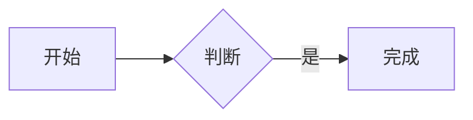

# EasyNote

[简体中文](README.md) | [English](README.en.md)

当前版本：`1.4.2`

面向个人与小团队的自托管 Markdown 笔记应用。前端 React 19 + TypeScript + Vite 打包为可安装 PWA；服务端是一个 Cloudflare Worker，同时提供 API、远程 MCP、OAuth 和静态资源；D1 保存账号与笔记，R2 保存私有图片与附件，Durable Object 广播变更，Cron 每小时清理过期数据。PDF 由 pdfmake 结构化生成、PDF.js 逐页预览。

## 目录

[已实现功能](#已实现功能) · [架构](#架构) · [快速开始](#快速开始) · [部署到 Cloudflare](#部署到-cloudflare) · [配置](#配置) · [API](#api) · [语法速查](#语法速查) · [快捷键](#快捷键) · [验证](#验证) · [费用](#费用) · [适用范围](#适用范围) · [更新说明](#更新说明)

## 已实现功能

**笔记与编辑**

- 新建、独立标题、Markdown 编辑与预览、停止输入 500 ms 自动保存、置顶、归档、标签、回收站与恢复，永久删除需二次确认。
- CodeMirror 6 编辑器；markdown-it 解析 + DOMPurify 清理；GFM 表格、脚注、代码高亮、安全 HTML block。
- 预览中直接勾选待办；双击标题、段落、列表项、表格或代码块即跳回对应源码行列。
- 大纲、反向链接与稳定内部链接 `[[笔记 UUID|显示标题]]`，目标改名后链接依然有效；正文中单独成段写 `[TOC]`（前后留空行）生成可点击的笔记目录，预览、分享与 PDF 一致。
- KaTeX 行内与块级公式；Pele 渲染流程图、脑图、时序图等图表，跟随深浅主题即时换色；预览或分享页中可将单张图表另存为 SVG / PNG，优先使用 SVG（矢量、清晰、体积小），PNG 便于粘贴到不支持 SVG 的软件。
- 历史版本：手动保存与 AI 写入生成快照（默认保留 20 份），可查看并恢复；恢复前自动快照当前内容。
- 多端协同：Durable Object WebSocket 推送账号级变更信号，客户端增量拉取权威数据，前台 30 秒轮询兜底。

**组织与检索**

- 目录最多 5 层，支持新建、重命名、移动、删除；同层目录名唯一。
- 拖放笔记或目录跨层级移动、调整同层顺序，也可用 Alt+↑ / Alt+↓ 微调；列表可按最近修改或手动排序，偏好按账号保存在浏览器。
- 全局搜索 `Cmd/Ctrl+K`、标签筛选、快速跳转命令面板。
- 任务中心聚合所有未完成 TODO，显示来源笔记与源码行号，点击即可跳回源码。

**分享与 AI 接入**

- 只读分享链接：1 小时 / 1 天 / 7 天 / 30 天 / 永久，可延期或取消；Token 仅存哈希，图片与附件按当前修订授权。
- 远程 MCP：任意 MCP 客户端连接 `https://你的域名/mcp` 即可使用搜索、批量读取与写入工具。
- 支持 OAuth（客户端自动注册 + PKCE S256），授权表单可选只读或读写；每次授权生成一个以客户端命名的集成令牌，可在设置中撤销。
- AI 写入进入普通版本历史，检索使用 FTS5 trigram + BM25 相关度排序。

**离线与 PWA**

- 可安装 PWA：应用外壳与预览脚本离线预缓存，支持离线冷启动与独立应用窗口。
- 按账号隔离的 IndexedDB 离线笔记库默认开启，镜像笔记正文、私有文件、全文搜索与待同步草稿；恢复会话后按原 revision 与 operationId 自动提交，冲突进入显式合并。
- 编辑锁保证同一账号单窗口编辑；已安装 PWA 回到前台自动接管编辑权。

**账号与安全**

- 多用户租户：初始化管理员、审批式自助注册、恢复代码、账号删除、HttpOnly 会话 Cookie、CSRF、来源检查与登录限流；笔记、版本、附件、分享和 AI 令牌均按 `user_id` 隔离，R2 Key 形如 `<user_id>/<file_id>`。
- 改密或全端登出会撤销其他浏览器会话与全部 AI 令牌；管理员不会影响自身的可用账号。
- 私有文件上传带配额预留与状态机（pending → ready → deleting），无引用对象按宽限期清理。

**导入导出与运维**

- ZIP v3 导出与导入保留目录结构和手动排序键（兼容 v2）；支持 Obsidian 目录、通用 Markdown/TXT ZIP 以及单个或多个 `.md` / `.markdown` / `.txt` 导入，外部链接改写为内部稳定链接。
- PDF 导出带逐页预览、A4/Letter、横竖方向与缩放；桌面端直接下载，iOS / Android 走系统分享面板。
- `backup.sh` 完整导出 D1 快照并逐个校验 R2 对象的大小与 SHA-256，`restore.sh --check` 先做只读预检，正式恢复只写入空资源。
- Cron 每小时清理过期会话、分享、登录计数、未引用文件，以及已申请删除的租户数据。

## 架构

```text
浏览器 / PWA（React 19 + TypeScript + Vite）
   │  HTTPS：/api/*  /mcp  /oauth/*  / 静态资源
   ▼
Cloudflare Worker（src/worker、src/ai）
   ├── D1              账号、会话、笔记、版本、目录、同步序号、FTS5、分享、令牌
   ├── R2              私有图片与附件（<user_id>/<file_id>）
   ├── Durable Object  NoteEvents：账号级变更广播，WebSocket Hibernation
   └── Cron（每小时）  清理与租户数据删除
```

### 关键机制

- **并发**：每次写入提交 `revision` 与随机 `operationId`；revision 不匹配返回 `409` 和服务器版本，客户端可用基于编辑起点的三方合并（`node-diff3`）或创建冲突副本解决。
- **增量同步**：`note_changes` 维护单调序号，`/api/sync` 按游标拉取完整笔记与删除记录；WebSocket 只传递失效信号，不承载正文。
- **离线提交**：草稿与镜像存放于 IndexedDB，恢复会话后按原 `operationId` 幂等重试。
- **删除**：删除写入 30 天墓碑，防止旧设备用旧 revision 重建；定时清理移除墓碑后该 ID 可重新使用。
- **数据迁移**：`migrations/` 中 `0001_initial` 为结构基线，`0002`~`0005` 依次加入 OAuth、目录、手动排序与任务扫描索引，部署脚本在发布代码前自动应用。

### 目录结构

```text
src/
├── client/                 # 前端
│   ├── App.tsx             # 登录、工作台、设置与对话框
│   ├── Editor.tsx          # CodeMirror 与安全 Markdown 预览
│   ├── useNotebook.ts      # 自动保存、修订冲突、列表与轮询
│   ├── merge.ts            # 笔记三方合并
│   ├── drafts.ts           # IndexedDB 草稿、离线镜像与私有文件
│   ├── api.ts              # API 调用与上传
│   ├── pdf.ts              # 结构化 PDF 生成、分页预览与平台导出
│   ├── transfer.ts         # ZIP 导出、校验、文件重映射与导入
│   ├── math.ts / knowledge.ts / i18n.ts / feedbackConfig.ts
│   ├── UserManagement.tsx / NoteSharing.tsx / ShareManagement.tsx / AccountSecurity.tsx / AiAccess.tsx
│   └── styles.css / main.tsx
├── worker/                 # 服务端
│   ├── index.ts            # 请求入口与 Cron
│   ├── auth.ts             # 多用户、会话、恢复、管理与限流
│   ├── notes.ts            # 笔记、标签、版本、软删除与清除
│   ├── events.ts           # Durable Object 变更通知
│   ├── images.ts           # 私有文件、配额预留、状态与清理
│   ├── oauth.ts            # OAuth 授权服务器
│   ├── features.ts         # 任务中心与只读分享
│   ├── integrations.ts     # AI 令牌、快照、增量同步与受控写入
│   └── core.ts             # 配置校验、大小限制与公共类型
├── ai/
│   ├── index.ts            # 远程 MCP 工具与 Resources
│   └── client.ts           # MCP 内部 API 客户端
└── shared/types.ts         # 前后端共享类型与限额
migrations/                 # D1 结构与增量迁移
scripts/                    # setup / maintenance / cloudflare / deploy 编排
test/                       # Miniflare API 测试、Playwright 浏览器测试与脚本测试
```

## 快速开始

需要 Node.js 22.12 或以上（自带 npm）以及 macOS / Linux 的 Bash，依赖统一按 `package-lock.json` 安装。

```bash
cd easynote
bash dev.sh
```

首次运行会准备依赖并交互式创建本地管理员，随后构建、初始化本地 D1/R2 并启动服务；默认地址 `http://127.0.0.1:8791`，`Ctrl+C` 停止。需要前端热更新时，可在服务启动后另开终端运行 `npm run dev:client`（`http://127.0.0.1:5174`）。

| 命令 | 用途 |
| --- | --- |
| `bash setup.sh` | 只准备依赖和本地账号，不启动服务 |
| `bash dev.sh [--port 8793]` | 一键本地启动，缺少账号配置时自动初始化 |
| `bash deploy.sh` / `bash deploy.sh --check` | 交互式生产部署 / 本地构建与部署预检 |
| `bash reset-password.sh --local` / `--remote` | 交互式重置本地 / 生产账号，并撤销该账号会话与 AI 令牌 |
| `bash backup.sh --remote` | 创建并校验完整 D1/R2 灾备 |
| `bash restore.sh <目录> --remote [--check]` | 恢复预检或恢复至空的 D1/R2 |
| `bash reset.sh --local` / `--remote` | 确认后清空本地 / 云端 D1、R2 与 Worker |
| `npm run test:ai` | 测试远程 Streamable HTTP MCP |

所有脚本入口都支持 `--help`。生产环境要求 HTTPS，仅本地命令允许环回 HTTP。

## 部署到 Cloudflare

1. **开通 R2**：在 Cloudflare Dashboard 的 **Storage & databases → R2 → Overview** 完成一次账号级结算确认，看到 **Create bucket** 即可返回终端。部署脚本会按 Token 自动创建或复用专属的 D1 与私有 R2 bucket。
2. **选择公开入口**：留空使用 `workers.dev`（脚本可代为初始化子域名），或输入完整主机名如 `notes.example.com` 使用 Worker Custom Domain。
3. **创建自定义 API Token**（[My Profile → API Tokens](https://dash.cloudflare.com/profile/api-tokens/)），Account Resources 选择目标账号：

| Scope | Permission | Level | 用途 |
| --- | --- | --- | --- |
| Account | Account Settings | Read | 发现 Token 可访问的账号 |
| Account | Workers Scripts | Edit | 创建或更新 Worker、静态资源、Cron 与 Secret |
| Account | D1 | Edit | 检查或创建数据库并执行 migrations |
| Account | Workers R2 Storage | Edit | 检查或创建私有 bucket |
| Zone | Zone | Read | 查找 Custom Domain 所属的 Active Zone |
| Zone | Workers Routes | Read | 检查目标主机名的 Route 冲突 |

最后两项仅在使用 Custom Domain 时需要，并在 Zone Resources 选择目标根域名。Token 只在终端隐藏输入，生命周期限定于本次运行；`wrangler.deploy.json` 以 `0600` 权限保存资源标识。

4. **执行部署**：`bash deploy.sh`。脚本准备依赖、检查并构建，随后创建缺少的 D1、私有 bucket 与账号级子域名，应用 migrations，部署 Worker，并校验公网 DNS 与 HTTPS。输入 `deploy <Worker 名称>` 即同时确认变更与待执行迁移。

后续更新在仓库根目录 `git pull --ff-only` 后再次运行 `bash deploy.sh` 即可，脚本会复用已保存的账号与资源，按顺序应用 `migrations/` 中尚未执行的迁移，再更新 Worker。

官方参考：[Wrangler API Token](https://developers.cloudflare.com/workers/wrangler/system-environment-variables/)、[Workers 权限](https://developers.cloudflare.com/workers/authorization/)、[Custom Domains](https://developers.cloudflare.com/workers/configuration/routing/custom-domains/)。

## 配置

服务器参数在 `wrangler.json` 的 `vars` 中显式配置，使用时校验类型与范围。

| 参数 | 默认值 | 含义 |
| --- | --- | --- |
| `MAX_NOTE_BYTES` | 262144 | 单篇正文 256 KiB |
| `MAX_IMAGE_BYTES` | 8388608 | 单张图片 8 MiB |
| `MAX_IMAGE_PIXELS` | 40000000 | 单张最多 4000 万像素 |
| `MAX_ATTACHMENT_BYTES` | 20971520 | 单个附件 20 MiB |
| `IMAGE_QUOTA_BYTES` | 1073741824 | 每账号 R2 文件总配额 1 GiB |
| `MAX_NOTES` | 5000 | 每账号笔记上限，含回收站 |
| `VERSIONS_KEPT` | 20 | 每篇保留的历史快照数，当前正文另存于 `notes` |
| `IMAGE_GRACE_HOURS` | 168 | 未引用文件的清理宽限期 |
| `SESSION_DAYS` | 30 | 会话固定有效天数 |
| `AUTOSAVE_MS` | 500 | 停止输入后的保存延迟（毫秒） |
| `POLL_SECONDS` | 30 | 前台同步检查间隔 |
| `LOGIN_WINDOW_SECONDS` / `LOGIN_IP_LIMIT` / `LOGIN_GLOBAL_LIMIT` | 900 / 20 / 200 | 登录限流窗口、每 IP 预算、实例失败预算 |
| `ACCOUNT_WINDOW_SECONDS` | 900 | 注册、恢复与 OAuth 客户端注册的计数窗口 |
| `REGISTRATION_IP_LIMIT` / `REGISTRATION_GLOBAL_LIMIT` | 5 / 50 | 注册限流 |
| `PASSWORD_RESET_IP_LIMIT` / `PASSWORD_RESET_GLOBAL_LIMIT` | 5 / 50 | 恢复代码限流 |
| `OAUTH_CLIENT_IP_LIMIT` / `OAUTH_CLIENT_GLOBAL_LIMIT` | 20 / 200 | OAuth 客户端注册限流 |
| `ALLOW_LOCAL_HTTP` | false | 本地命令的环回 HTTP 开关 |

标题 256 字符、标签最多 20 个且每个 40 字符、单篇最多引用 80 个私有文件，这些校验位于 `src/worker/notes.ts`。客户端成功提示时长由 `src/client/feedbackConfig.ts` 的 `SUCCESS_FEEDBACK_DURATION_MS` 控制（默认 2000 毫秒）。

## API

| 方法 / 路径 | 功能 |
| --- | --- |
| `GET /api/session` | 账号状态、CSRF、客户端参数 |
| `POST /api/login` / `POST /api/logout` / `POST /api/register` | 登录、登出、申请注册 |
| `POST /api/account/password` / `logout-all` / `recovery-code` / `reset-password` | 改密、全端登出、生成恢复代码、用恢复代码重置密码 |
| `DELETE /api/account` | 申请删除当前租户 |
| `GET/POST /api/admin/users`、`PATCH/DELETE /api/admin/users/:id`、`PATCH /api/admin/settings/registration` | 管理员用户管理与注册开关 |
| `GET /api/events` | 同源 WebSocket，接收当前账号的变更信号 |
| `GET /api/sync`、`GET /api/sync/cursor` | 按单调序号增量同步完整笔记与删除记录 |
| `GET /api/tasks` | 未完成 TODO 及源码位置，用 `cursor`（`updated_at:id`）与 `limit`（50）分页 |
| `GET /api/notes` | 列表、搜索、视图与标签筛选，50 条分页 |
| `POST /api/notes/duplicates` | 批量查询已有的笔记内容指纹 |
| `POST /api/notes/:id`、`GET /api/notes/:id`、`PUT /api/notes/:id`、`DELETE /api/notes/:id` | 创建（revision 0）、读取、按 revision 更新、永久删除 |
| `GET /api/notes/:id/versions`、`GET /api/notes/:id/backlinks`、`GET /api/tags` | 历史版本、反向链接、标签 |
| `GET /api/shares`、`GET/POST/PATCH/DELETE /api/notes/:id/share` | 分享列表与创建、延期、撤销 |
| `GET /api/public/shares/:token`、`/public/shares/:token/(images\|files)/:id` | 免登录读取有效分享及其引用的文件 |
| `PUT/GET /api/images/:id`、`PUT/GET /api/files/:id` | 上传或鉴权读取图片与附件 |
| `GET/POST /api/integrations/tokens`、`DELETE /api/integrations/tokens/:id` | 创建、列出、撤销 AI 接入令牌 |
| `GET /api/integrations/notes`、`/notes/batch`、`/notes/:id`、`POST/PUT /api/integrations/notes/:id` | Bearer 令牌下的搜索（最多 20 篇批量读取）、读取与受控写入 |

浏览器写接口要求同源 `Origin` 与 `X-CSRF-Token`；AI 接口使用独立 Bearer 令牌。所有数据接口按账号隔离。

## 语法速查

| 语法 | 用法 |
| --- | --- |
| `- [ ] 待办` / `- [x] 已完成` | 预览中点击即勾选并回写源码 |
| `[[笔记 UUID\|显示标题]]` | 内部链接，目标改名后仍可打开 |
| 单独成段（前后空行）的 `[TOC]` | 生成可点击的笔记目录，按标题层级缩进；引用块中的标题不计入，PDF 导出保留目录文字 |
| `$x^2$` / `$$…$$` | 行内公式 / 独立公式块（KaTeX） |
| `正文[^1]` 加文末 `[^1]: 说明` | 脚注，可点击跳转与回跳 |
| ` ```mermaid ` 代码块 | 图表；首行写 `flowchart LR`、`mindmap`、`sequenceDiagram` 等。图表右上角可另存为 SVG 或 PNG |
| ` ```python ` 代码块 | 代码高亮，未知语言降级为纯文本 |
| `\| :--- \| :---: \| ---: \|` | GFM 表格的左、中、右列对齐 |
| HTML block | 经 DOMPurify 过滤，保留 `<section>`、`<mark>`、`<kbd>`、`<details>`、`<summary>` 等安全结构标签 |

````markdown

````

可直接导入示例验证渲染：[`examples/markdown-syntax-demo.md`](examples/markdown-syntax-demo.md)（全套语法）、[`examples/math-demo.md`](examples/math-demo.md)（公式与图表混排）、[`examples/mermaid-all-types-demo.md`](examples/mermaid-all-types-demo.md)（20 种图型）、[`examples/mermaid-html-demo.md`](examples/mermaid-html-demo.md)（图表与 HTML block）。

## 快捷键

| 快捷键 | 操作 |
| --- | --- |
| `Cmd/Ctrl+K` | 聚焦全局搜索并全选关键词，跨目录查找笔记 |
| `Cmd/Ctrl+O` | 打开快速跳转，搜索笔记或执行命令 |
| `Cmd/Ctrl+Enter` | 在当前目录新建笔记 |
| `Cmd/Ctrl+S` | 立即保存、同步并记录历史版本 |
| `Cmd/Ctrl+E` | 切换编辑与预览，保留源码光标位置 |
| `Cmd/Ctrl+,` | 打开设置 |
| `Cmd/Ctrl+\` | 显示/隐藏导航侧栏；窄屏打开导航菜单 |
| `Cmd/Ctrl+.` | 显示/隐藏大纲与反向链接 |
| `Cmd/Ctrl+Shift+K` | 插入内部笔记链接 |
| `Cmd/Ctrl+Shift+L` | 切换深色/浅色外观 |
| `Cmd/Ctrl+B` / `Cmd/Ctrl+I` | 切换粗体 / 斜体 |
| `Cmd/Ctrl+Shift+Z` / `Ctrl+Y` | 重做编辑 |
| `Cmd/Ctrl+P` | 导出当前笔记为 PDF |
| `Cmd/Ctrl+/` | 查看快捷键 |

`Cmd/Ctrl+Shift+F` 保留为全局搜索的兼容快捷键，弹窗打开时全局快捷键让位输入。

## 验证

```bash
bash deploy.sh --check
npm run build          # 类型检查 + i18n 检查 + 构建
npm test               # API 与 AI 测试
npm run test:scripts   # 脚本流程测试（临时目录与模拟 Wrangler）
npx playwright install chromium && npm run test:ui
```

API 测试运行在内存 D1 / R2 上；浏览器测试自动在 `127.0.0.1:8792` 启动独立临时实例，测试账号与数据仅存在于测试环境。脚本测试使用模拟 npm / Wrangler，交互流程通过系统 `expect` 驱动伪终端。

覆盖范围包括多租户隔离、注册审批、恢复与账号删除、保存冲突与幂等、任务定位、限时与永久分享、ZIP 与 Obsidian 导入、离线冷启动与回传、AI 令牌与真实 MCP、删除墓碑、私有文件、灾备校验、移动布局与编辑锁。

## 费用

计费范围是 Workers、D1 与 R2 Standard；价格核对日期 2026-09-17。个人和小团队通常在免费额度内。

| 计费项 | 免费额度 | 超出单价 |
| --- | --- | --- |
| Worker 动态请求 | 100,000 次/天 | 每月含 1,000 万次，之后 `$0.30/百万次` |
| Worker CPU | 每次请求 10 ms | 每月含 3,000 万 CPU-ms，之后 `$0.02/百万 CPU-ms` |
| D1 行读取 / 行写入 | 500 万 / 10 万行/天 | 含 250 亿 / 5,000 万行，之后 `$0.001` / `$1.00` 每百万行 |
| D1 存储 | 5 GB（单库 500 MB） | `$0.75/GB-month` |
| R2 Standard 存储 | 10 GB-month/月 | `$0.015/GB-month` |
| R2 Class A / Class B | 100 万 / 1,000 万次每月 | `$4.50` / `$0.36` 每百万次 |
| D1 / R2 出站流量 | 免费 | — |

典型用量参考：

| 场景 | 预计月费 |
| --- | ---: |
| 1000 篇、平均 20 KiB、5 个历史、附件 ≤ 1 GiB、单设备 | **$0** |
| 1000 篇、平均 20 KiB、接近 20 个历史（原始正文约 410 MiB，索引可能推过 500 MB） | **$0 或 $5 起** |
| 1000 篇、平均 50 KiB、10 个历史（原始正文已超 Free 单库上限） | **$5 起** |
| D1 不超限、R2 合计 20 GB / 50 GB | 约 `$0.15` / `$0.60` |

自动保存只更新当前正文，历史槽位由手动保存和 AI 写入消耗，把 `VERSIONS_KEPT` 设为 5～10 可为 D1 留出充足余量。上线后观察 Workers 的 Requests、CPU Time 与 Error 1027，D1 的 `rows_read`、`rows_written` 与数据库大小，以及 R2 的存储与操作次数，任一达到免费额度 70% 时再调整 `POLL_SECONDS`、`VERSIONS_KEPT` 或套餐。以上不含域名、税费与外部备份存储；实际以当期账单为准：[Workers 定价](https://developers.cloudflare.com/workers/platform/pricing/)、[D1 定价](https://developers.cloudflare.com/d1/platform/pricing/)、[D1 限制](https://developers.cloudflare.com/d1/platform/limits/)、[R2 定价](https://developers.cloudflare.com/r2/pricing/)。

## 适用范围

- 产品定位聚焦 Markdown 笔记、单篇只读分享与远程 MCP；AI 通过用户主动创建的受限令牌访问所属租户。
- 离线镜像沿用浏览器配置文件与设备账号的安全边界，敏感设备建议启用系统磁盘加密。
- 数据由 Cloudflare 账号内的访问控制保护，账号管理员拥有基础设施级访问权限。
- 列表使用 offset 分页，跨设备新增内容后可手动刷新页边界；AI 检索基于 FTS5，语义向量检索可作为后续扩展。
- 生产上线前建议用独立临时实例验证账号配置、备份恢复与 Cloudflare 用量。

## 更新说明

`1.4.2`（2026-10-25）：修复弹窗默认聚焦右上角关闭按钮的问题；`Cmd/Ctrl+O` 快速跳转后搜索框直接获得焦点，可立即输入过滤与 ↑/↓ 选择，关闭按钮不再出现多余的选中框，回车也不会误关弹窗。

`1.4.1`（2026-10-19）：目录移除自动序号，仅保留层级缩进，避免与标题自身编号重复；嵌套目录样式统一，跳转、分享、独立阅读窗口与 PDF 行为不变。

版本真源是本目录的 `package.json`，同步规则在 [`version.config.json`](version.config.json)；仓库根的 `versions.json` 与版本表由脚本生成。提交功能更新前在仓库根目录执行：

```bash
node scripts/version.mjs bump easynote patch   # minor 用于新增功能，major 用于不兼容变更
node scripts/version.mjs check
```

脚本会按配置同步本 README、根 README、`package.json`、锁文件和应用显示版本。

- 完整版本历史：[`CHANGELOG.md`](CHANGELOG.md)
- AI / MCP 接入：[`docs/AI_INTEGRATION.md`](docs/AI_INTEGRATION.md)
- 备份与恢复：[`docs/DISASTER_RECOVERY.md`](docs/DISASTER_RECOVERY.md)
- 可导入的语法与图表示例：[`examples/`](examples/)
