# EasyNote Mermaid 全图型验收

本文件包含 20 个 Mermaid fenced code block（预览上限正好 20），用于验收 Pele 渲染器对常见图型的覆盖。
导入后在预览模式查看；单个图表超过 20 个时，超出部分会显示错误提示。

## 流程图 Flowchart

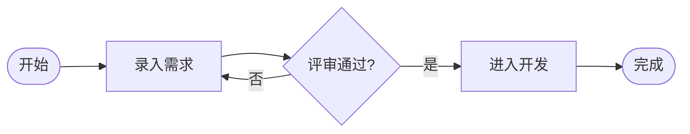

## 时序图 Sequence

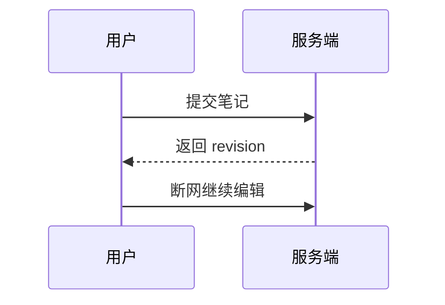

## 类图 Class

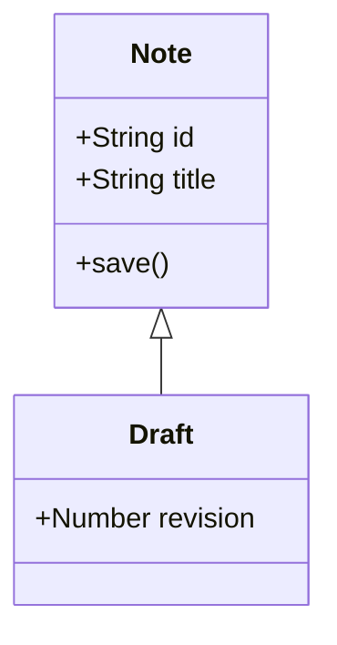

## 状态图 State

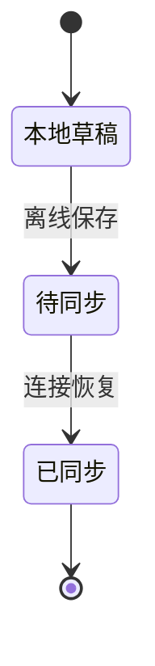

## 实体关系图 ER

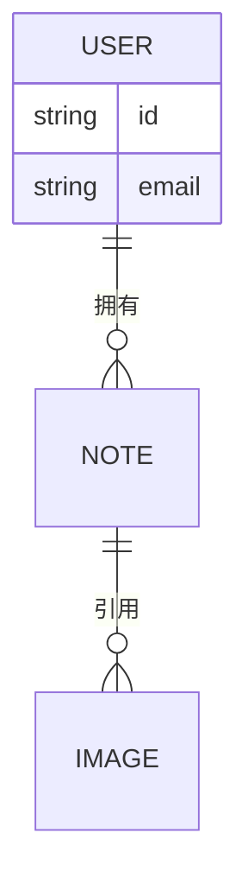

## 需求图 Requirement

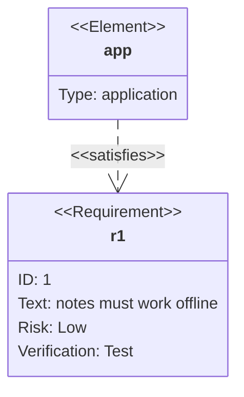

## 脑图 Mindmap

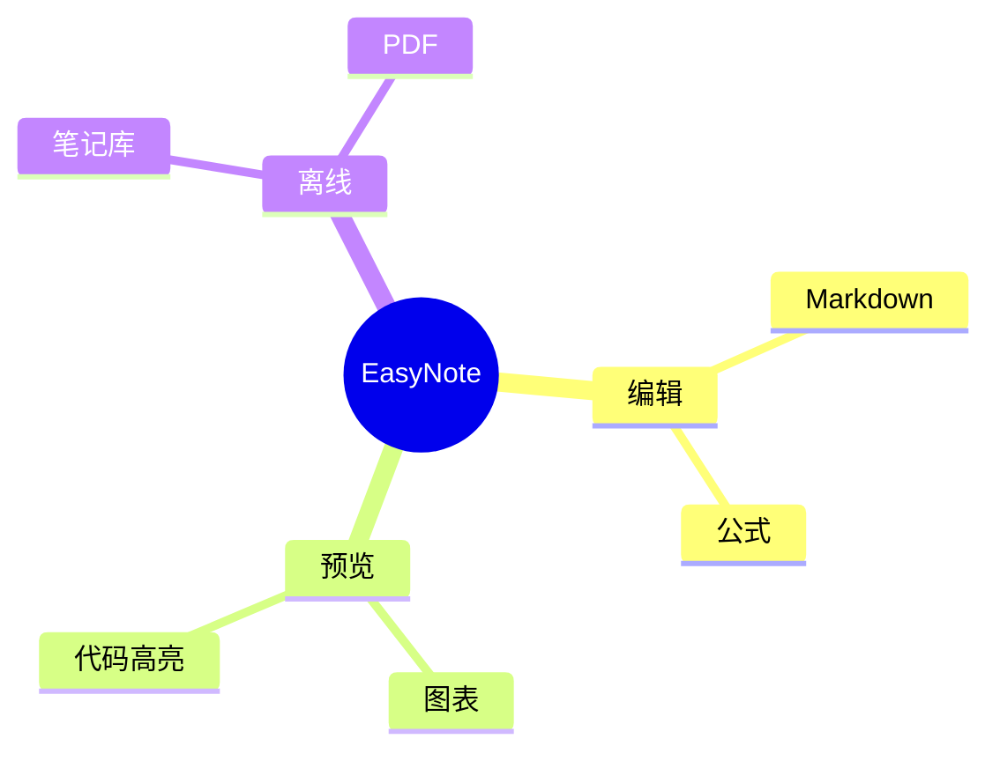

## 时间线 Timeline

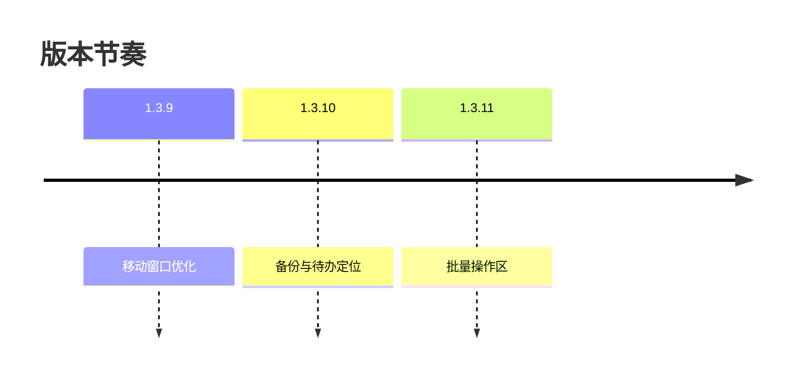

## 用户旅程 Journey

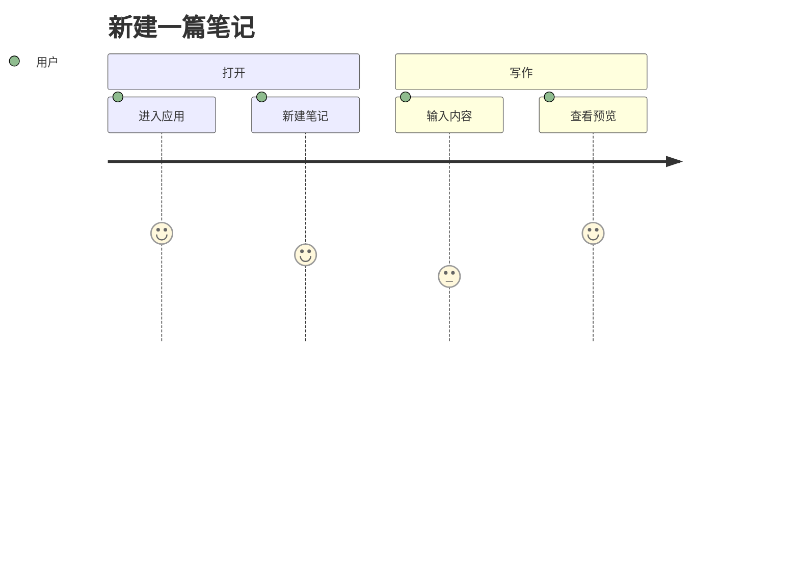

## 甘特图 Gantt

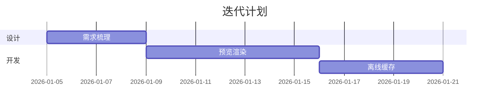

## 饼图 Pie

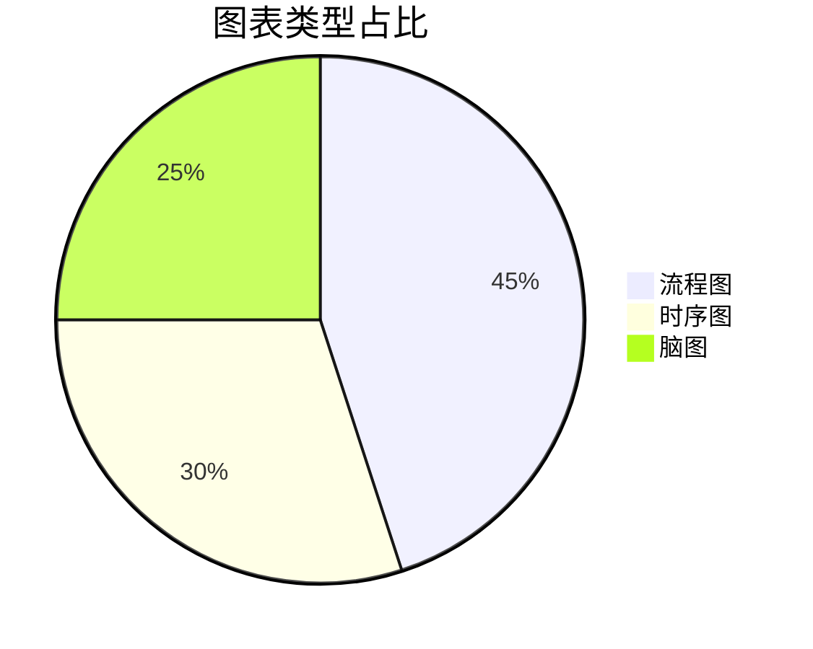

## 四象限 Quadrant

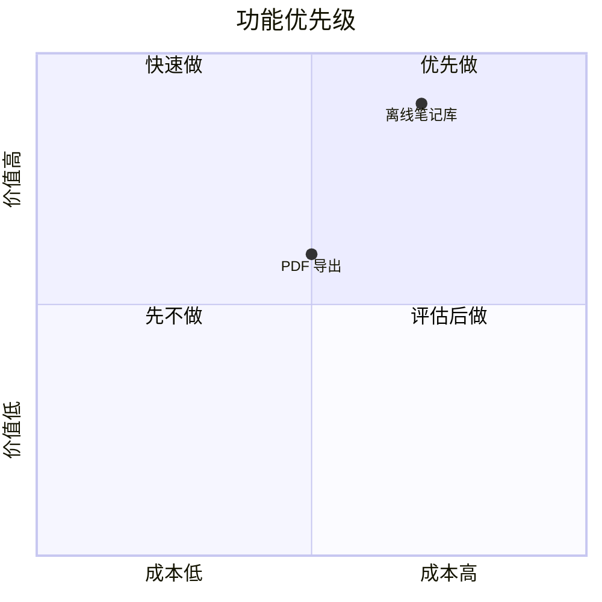

## Git 图 GitGraph

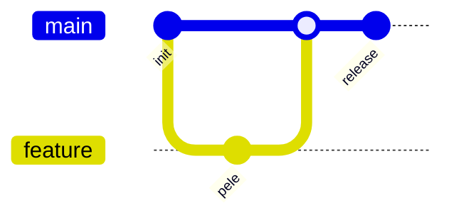

## 桑基图 Sankey

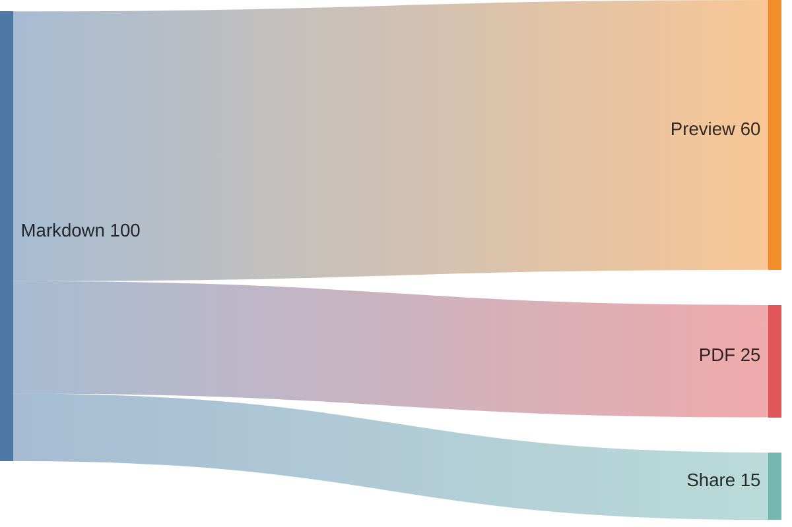

## 坐标图 XYChart

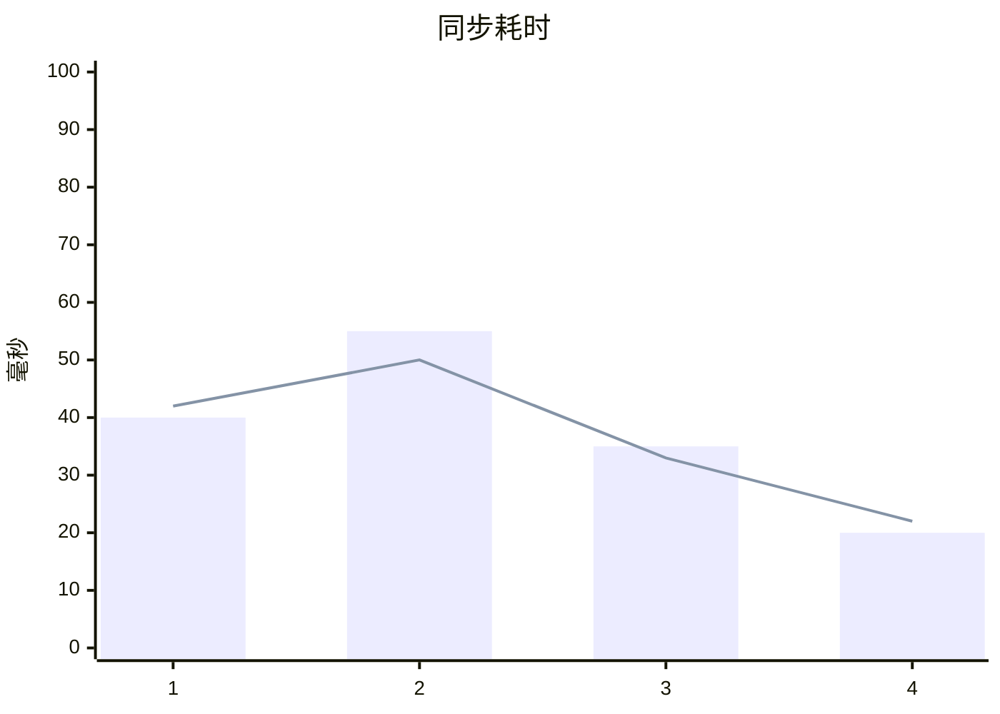

## 块图 Block

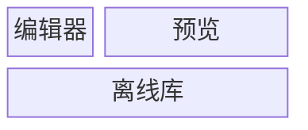

## 架构图 Architecture


## 雷达图 Radar

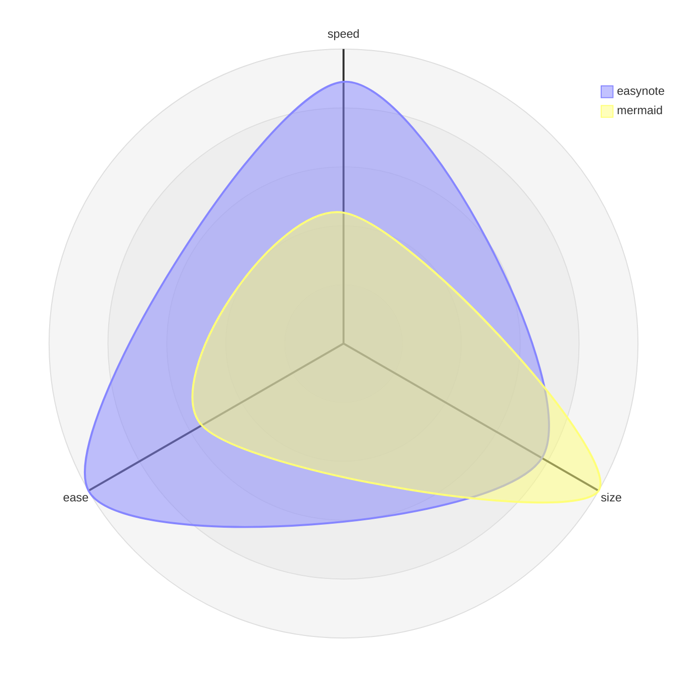

## 泳道图 Swimlane

```mermaid
swimlane-beta
  lane[作者]
    a1[撰写笔记]
    a2[查看预览]
  lane[服务端]
    b1[保存 revision]
  a1 -->|提交| b1
```

## C4 上下文图

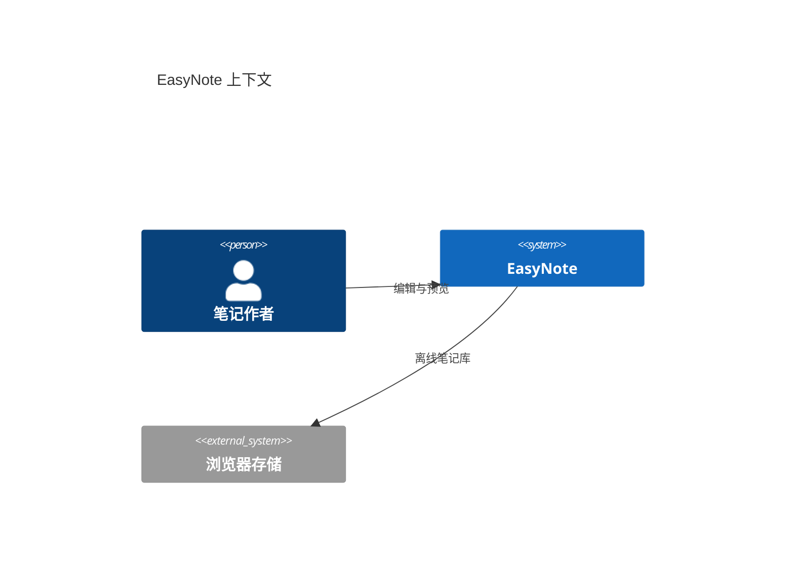

## 已知限制（Pele 渲染器）

- `sankey-beta` 的节点名不支持非 ASCII 字符，中文会报 `syntax` 错误，改用英文或拼音。
- `requirementDiagram` 的字段值以中文开头会报 `syntax` 错误（`text: 需要可用` 失败，`text: notes must work offline` 正常）。
- `xychart-beta` 的 `title` 必须加引号（`title "曲线"`）。
- `swimlane-beta` 不是 mermaid 官方语法。泳道写成 `lane[名称]`，节点带 id（`a1[任务]`），连线用 id（`a1 -->|标签| b1`）；`lane A` 和 `write --> save` 都会报解析错。
- 本文件正好 20 个图表，等于预览的单篇渲染上限。
